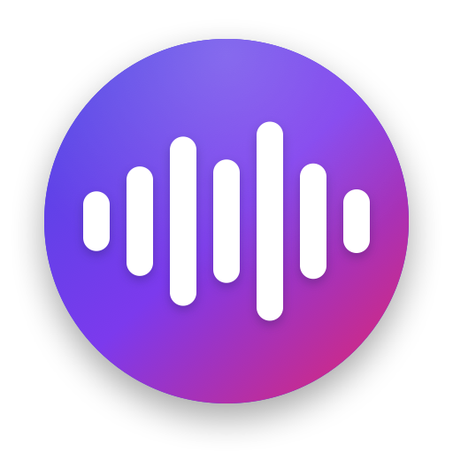

<p align="center">
  
</p>

<h1 align="center">Voxa</h1>

<p align="center"><strong>Your voice, typed.</strong></p>

<p align="center">
  A native macOS menu bar app for dictation. Press <kbd>⌥ Space</kbd>, speak, and press it again.<br>
  Your words appear in the app you're using, cleaned up and ready to send.
</p>

<p align="center">
  
  
  
</p>

---

## Why Voxa

Talking is about three times faster than typing. Voxa turns speech into text in any app with one shortcut. It needs no Terminal, no Xcode project and no admin password. It was built for writing long prompts to AI tools like Claude Code, and it works anywhere you type.

## Highlights

- **One shortcut.** <kbd>⌥ Space</kbd> starts and stops recording. <kbd>esc</kbd> cancels. For recordings over 30 seconds, Voxa asks before throwing anything away.
- **Words appear as you speak.** Voxa streams audio live to OpenAI (`gpt-live-transcribe`), so the text is almost ready by the time you stop.
- **A light clean-up, never a rewrite.** `gpt-4.1-mini` fixes punctuation and obvious mistakes, and nothing else. Built-in checks catch a model that answers, translates or shortens your words. When that happens, you get the raw transcript instead.
- **Pastes for you.** The text lands where you're typing and stays on the clipboard. An optional setting presses Return as well, so you can send a prompt hands-free.
- **Works offline.** With no key, no network, or OpenAI switched off, Voxa uses local Whisper (`base.en`), and your voice stays on your Mac.
- **A safety net.** If the live stream fails, Voxa uploads the whole recording to `gpt-4o-transcribe`.
- **Polished recording window.** A floating panel at the top of the screen shows a live waveform or your words so far. The gradient drifts while Voxa listens and speeds up while it transcribes. It never takes focus from the app you're typing in.
- **Dashboard.** It shows your dictations today, words dictated, time saved compared with typing, recent dictations and every setting in one place.
- **Timed sounds.** The start sound plays once the mic is live. The stop sound plays after the last half second is captured, so your final word is never cut off.
- **Private key storage.** Your OpenAI key lives in the macOS Keychain, never in a file.

## Branding

| Element | Detail |
|---|---|
| **Name** | Voxa, from *vox*, Latin for "voice" |
| **Tagline** | Your voice, typed. |
| **Logo** | White sound-wave bars in a gradient circle |
| **Colors** | Indigo `#4F46E5` → Magenta `#DB2777` |
| **Typeface** | SF Pro Rounded (the macOS system font) |

The icon is drawn in code by [`mac/icon.swift`](mac/icon.swift). Every build makes it at all macOS icon sizes.

## Requirements

- macOS with the Xcode Command Line Tools (`xcode-select --install`)
- An OpenAI API key (optional, because Voxa runs locally without one)
- [uv](https://github.com/astral-sh/uv) for the offline Whisper fallback

## Install

```sh
git clone https://github.com/grzybekkarol777-tech/voxa.git
cd voxa
uv sync                  # Python environment for the offline fallback
mac/make-cert.sh         # once: a self-signed signing identity, so macOS remembers permissions
mac/build.sh             # builds, signs and installs ~/Applications/Voxa.app
```

Add your OpenAI key to the Keychain. Copy the key first, then run:

```sh
security add-generic-password -U -a "$USER" -s dictate-openai -w "$(pbpaste)" && pbcopy < /dev/null
```

Open **Voxa** from `~/Applications` and allow the microphone when asked.

## Use

1. Press <kbd>⌥ Space</kbd> and speak.
2. Press <kbd>⌥ Space</kbd> again to stop.
3. Your text is pasted into the front app and copied to the clipboard.

Press <kbd>esc</kbd> while recording to cancel.

**Settings** (in the dashboard): Use OpenAI, Paste into the front app, Press Return after pasting, and Open at Login.

> Pasting into most apps needs Accessibility access. In Terminal, Voxa types through AppleScript instead, which needs no admin rights.

## Test without a microphone

```sh
say -o clip.wav --file-format=WAVE --data-format=LEI16@24000 "Testing Voxa from the command line."
~/Applications/Voxa.app/Contents/MacOS/Voxa --selftest clip.wav
```

This prints the live, upload, clean-up and local results side by side.

## Project layout

| Path | What it is |
|---|---|
| `mac/Sources/Voxa/main.swift` | The app: hotkeys, recording, transcription, clean-up and pasting |
| `mac/Sources/Voxa/Dashboard.swift` | The dashboard window: stats, history and settings |
| `mac/icon.swift` | Draws the logo |
| `mac/build.sh` | Builds with `swiftc`, signs, and installs |
| `dictate.py` | The original Python version, kept in step with the Swift app |
| `local_transcribe.py` | Offline Whisper, used by the Swift app |
